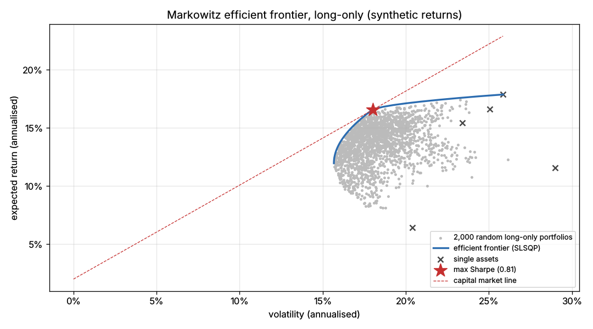

# Portfolio Optimization

Long-only Markowitz mean-variance optimisation, solved numerically with SciPy SLSQP. It computes the
max-Sharpe portfolio and the true efficient frontier. The data is **synthetic** (seeded), so the
output shows the method, not a market.

[](https://github.com/VenkataVinesh/Portfolio-Optimization-Dashboard/actions/workflows/ci.yml)




## Quick start

```bash
git clone https://github.com/VenkataVinesh/Portfolio-Optimization-Dashboard.git
cd Portfolio-Optimization-Dashboard
pip install -r requirements.txt
python optimization.py                                  # prints weights, writes efficient_frontier.png
pip install -r requirements-dev.txt && pytest -q
```

## How it works

- **Market** (`synthetic_market`): five assets, expected returns drawn from 5–20%. The covariance is a
  one-factor model, `B Bᵀ + D`, so it is positive-definite by construction.
- **Max Sharpe** (`max_sharpe`): minimise `−(wᵀμ − r_f) / √(wᵀΣw)` subject to `Σw = 1` and
  `0 ≤ w ≤ 1`, with r_f = 2%.
- **Efficient frontier** (`efficient_frontier`): for each target return, from the minimum-variance
  portfolio up to the best single asset, minimise `wᵀΣw` subject to `wᵀμ = target`, `Σw = 1`, `w ≥ 0`.
- The plot overlays 2,000 random long-only portfolios. None of them lie above or to the left of the
  frontier, and `tests/` checks exactly that.

## Results (synthetic data, `python optimization.py`)

| Asset | A | B | C | D | E |
|---|---:|---:|---:|---:|---:|
| Max-Sharpe weight | 25.44% | 0.00% | 33.14% | 41.42% | 0.00% |

Expected return 16.55%, volatility 18.00%, Sharpe 0.809.

## Limitations

- Synthetic inputs. With real data, the estimates of μ dominate the result: mean-variance
  optimisation is notoriously sensitive to expected-return error. Shrinkage or Black-Litterman would
  be the next step.
- Single period, long-only, no transaction costs, no turnover limits.
- Despite the repository name, this is a script, not a dashboard.

## Project layout

```
optimization.py     model, solvers, plot
tests/              pytest: PD covariance, constraints, optimality, frontier dominance
```

## License

MIT, see [LICENSE](LICENSE).
